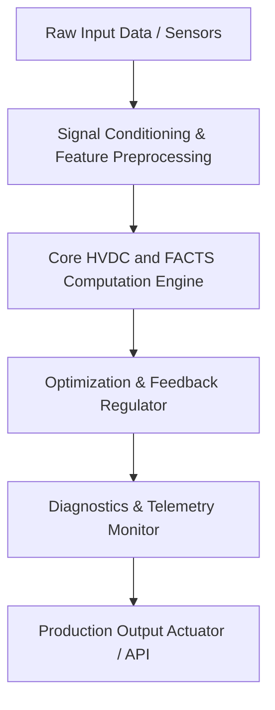

# Industrial Capstone Project: End-to-End HVDC and FACTS Engineering Design

**Course:** EE3681 - HVDC and FACTS  
**Credit Weight:** 3-Credit Capstone Component  
**Recommended Timeline:** 4 Weeks  

---

## 1. Executive Industrial Problem Statement
Modern high-performance engineering applications (e.g. autonomous vehicles, aerospace avionics, cloud accelerators, power grid converters) demand strict compliance with latency, precision, and thermal/stability boundaries. Students are required to design, simulate, optimize, and benchmark a complete, production-grade **HVDC and FACTS** architecture from specification to hardware verification.

---

## 2. System Architecture & Flowchart

---

## 3. Mandatory Engineering Deliverables
1. **System Specification Document (SSD):** Detailed mathematical trade-off analysis, pole-zero placements, or network hyperparameter search.
2. **Production-Quality Source Code:** Clean, modular Python/C++ codebase with full type annotations, docstrings, and error handling.
3. **Automated CI/CD Test Suite:** Minimum 90% unit test code coverage using `pytest` verifying corner cases, noise injection, and fault tolerance.
4. **Performance Benchmark Report:** Telemetry curves, latency distributions ($p_{50}, p_{99}$), and efficiency Pareto curves.

---

## 4. Evaluation Rubric & Defense Criteria
- **Architectural Soundness & Theoretical Depth (30%):** Rigorous justification of topology choices from first principles.
- **Implementation Quality & Robustness (35%):** Code modularity, exception safety, and unit test coverage.
- **Empirical Validation & Benchmark Results (20%):** Thorough experimental validation against target specifications.
- **Viva Voce & Technical Defense (15%):** Deep conceptual understanding during peer and instructor review.
